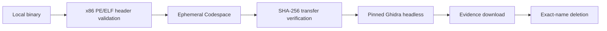

# Codespace x86 Reverse Engineering Toolkit

[](https://github.com/sanchomuzax/codespace-x86-re-toolkit/actions/workflows/ci.yml)
[](https://github.com/sanchomuzax/codespace-x86-re-toolkit/releases)

Agent-independent automation for authorized static analysis of x86/x86-64 PE
and ELF binaries with Ghidra headless in an ephemeral GitHub Codespace.

The repository is both:

- a directly usable command-line toolkit; and
- a portable [Agent Skills](https://agentskills.io/) package for Codex, Claude
  Code, and clients that scan the shared `.agents/skills` convention.

It ships no binaries and never executes the target. Ghidra is downloaded from
its official release, pinned to a version and SHA-256 checksum.

## Why this exists

Reverse engineering can consume enough CPU and memory to disrupt a developer
machine. This toolkit moves the work into a short-lived Codespace, automates
the lifecycle, and keeps the evidence workflow reproducible:

- x86/x86-64 PE/ELF validation before upload;
- SHA-256 verification after transfer;
- pinned Ghidra 12.1.2 with Java 21;
- full headless analysis and custom Java GhidraScripts;
- isolated per-script OSGi source directories;
- bounded background monitoring for long agent-driven runs;
- safe exact-name cleanup and short retention defaults;
- an evidence-driven binary archaeology methodology.



The binary and downloaded evidence stay at the two ends of the flow. The
resource-heavy analysis and untrusted extracted content remain inside the
disposable Codespace until exact-name deletion.

## Prerequisites

- Python 3.10 or newer;
- [GitHub CLI](https://cli.github.com/) authenticated with Codespaces access;
- a GitHub account with available Codespaces quota;
- legal authorization to inspect the target binary.

```bash
gh auth status
gh auth refresh -h github.com -s codespace  # only if the scope is missing
```

## Quick start

```bash
git clone https://github.com/sanchomuzax/codespace-x86-re-toolkit.git
cd codespace-x86-re-toolkit/skills/codespace-x86-re

python3 scripts/codespace_re.py doctor
NAME=$(python3 scripts/codespace_re.py create | tail -n 1)
python3 scripts/codespace_re.py setup --codespace "$NAME"
python3 scripts/codespace_re.py upload \
  --codespace "$NAME" --binary /absolute/path/program.exe
python3 scripts/codespace_re.py analyze --codespace "$NAME" --timeout 600
python3 scripts/codespace_re.py run-script \
  --codespace "$NAME" --script scripts/HelloScript.java
python3 scripts/codespace_re.py download \
  --codespace "$NAME" --result script-HelloScript.log \
  --output ./script-HelloScript.log
python3 scripts/codespace_re.py delete --codespace "$NAME"
python3 scripts/codespace_re.py list
```

The default `basicLinux32gb` machine uses 2 CPU/8 GiB to reduce cost. For a
larger target, pass `--machine standardLinux32gb` to both `doctor` and
`create`. GitHub billing and availability vary by account; inspect the current
[Codespaces billing documentation](https://docs.github.com/en/billing/managing-billing-for-your-products/managing-billing-for-github-codespaces/about-billing-for-github-codespaces)
before a long run.

For a reproducible installation, clone a released tag instead of the moving
default branch:

```bash
git clone --branch v0.2.1 --depth 1 \
  https://github.com/sanchomuzax/codespace-x86-re-toolkit.git
```

## Serve REA over MCP from the Codespace

[REA](https://github.com/morluto/rea) can use this Codespace's pinned Ghidra as
its native analysis engine while the agent itself runs elsewhere, for example
on an ARM machine where Ghidra's native decompiler is not available. After
`create` and `setup`, register this stdio MCP server in the agent:

```bash
python3 skills/codespace-x86-re/scripts/codespace_re.py rea-mcp
```

It selects the only running `codespace-x86-re` Codespace (it never starts a
stopped one; pass `--codespace NAME` when there are several), checks that Ghidra and Node.js
are installed, and runs the pinned `rea-agents` MCP server there over
`gh codespace ssh`. Only MCP traffic reaches stdout; profile output and
diagnostics go to stderr. Analysis targets must be inside the Codespace, so
pass REA the remote path, such as the uploaded `/var/tmp/codespace-x86-re/input.bin`.
REA's Ghidra analysis is ephemeral: every new MCP session imports the target
again. Set the client's call deadline to about 1000 seconds for large binaries,
and delete the Codespace when the session ends.

## Install as an Agent Skill

Clone the repository, then choose one target. Symlinking keeps the installed
skill updated with the clone:

```bash
# Open Agent Skills shared convention
python3 scripts/install_skill.py --client agents

# OpenAI Codex
python3 scripts/install_skill.py --client codex

# Claude Code
python3 scripts/install_skill.py --client claude
```

Add `--copy` for a standalone copy or `--target /custom/skills/root` for any
other compatible agent. Restart the client after installation, then invoke
`$codespace-x86-re` or ask it to analyze an authorized x86 binary in a
Codespace.

## Use as a template

This repository is marked as a GitHub template. Create your own copy with
**Use this template**, then pass its repository to the toolkit:

```bash
python3 scripts/codespace_re.py create --repo OWNER/YOUR-REPOSITORY
```

Keep custom scripts and documentation in Git. Keep target binaries, Ghidra
projects, extracted proprietary resources, credentials, and private research
notes out of Git.

## Methodology

The portable skill includes
[`references/methodology.md`](skills/codespace-x86-re/references/methodology.md),
covering:

- cheap-to-expensive evidence ordering;
- strings, RTTI, resources, imports/exports, and shipped definitions;
- unknown container reconstruction with invariants and round trips;
- targeted disassembly/decompilation;
- live-versus-dead code classification;
- falsification passes, confidence labels, and negative results;
- prompt-injection handling for strings extracted from binaries.

The methodology is intentionally product-, project-, and agent-independent.

## Safety boundaries

- Static analysis only: the toolkit does not execute the target.
- Target files are stored under `/var/tmp/codespace-x86-re`, outside the Git
  checkout.
- `delete` accepts one validated Codespace name; there is no delete-all mode.
- Downloads accept a single filename from the remote `results/` directory.
- Extracted strings, comments, and resources are untrusted input.
- Delete the Codespace after exporting reproducible evidence.

## Cost-bounded integration smoke

The manually dispatched `Codespace integration smoke` workflow exercises the
real lifecycle:

```text
create -> setup -> upload sample -> analyze -> run-script -> download -> delete
```

It is never triggered by a push or pull request. It requires the operator to
set the boolean cost confirmation and uses the cheapest default machine, a
30-minute job timeout, a 10-minute idle timeout, one-hour retention fallback,
and exact-name cleanup. Evidence logs are retained as a workflow artifact for
seven days.

GitHub's workflow `GITHUB_TOKEN` cannot manage a user's Codespaces. Configure a
dedicated repository secret named `CODESPACES_PAT` containing a narrowly scoped
token with Codespaces access, then dispatch the workflow from the Actions tab.
Do not reuse a broad personal or automation token. Review GitHub's current
[Codespaces authentication guidance](https://docs.github.com/en/codespaces/codespaces-reference/security-in-github-codespaces#authentication)
and billing before enabling it.

Cleanup runs even after an earlier step fails. Forced cancellation or a runner
failure can prevent cleanup code from executing, so the one-hour retention
period is the final safety net; verify the Codespaces list after such a failure.

## Maintaining the Ghidra pin

Follow the documented
[Ghidra release and checksum update procedure](docs/ghidra-version-update.md).
It cross-checks the official release body, GitHub asset digest, and locally
calculated SHA-256 before changing the pin, and requires the manual Codespace
smoke before release.

## Development

```bash
python3 -m unittest discover -s tests -v
python3 scripts/validate_skill.py
python3 -m py_compile \
  skills/codespace-x86-re/scripts/codespace_re.py \
  scripts/install_skill.py scripts/validate_skill.py
```

CI runs the unit suite and strict repository validation on Python 3.10, 3.11,
3.12, and 3.13. A separate job also runs the official Agent Skills
`skills-ref` validator pinned to a reviewed upstream commit.

Licensed under GPL-3.0-or-later. Ghidra is downloaded separately and remains
under its own license.
